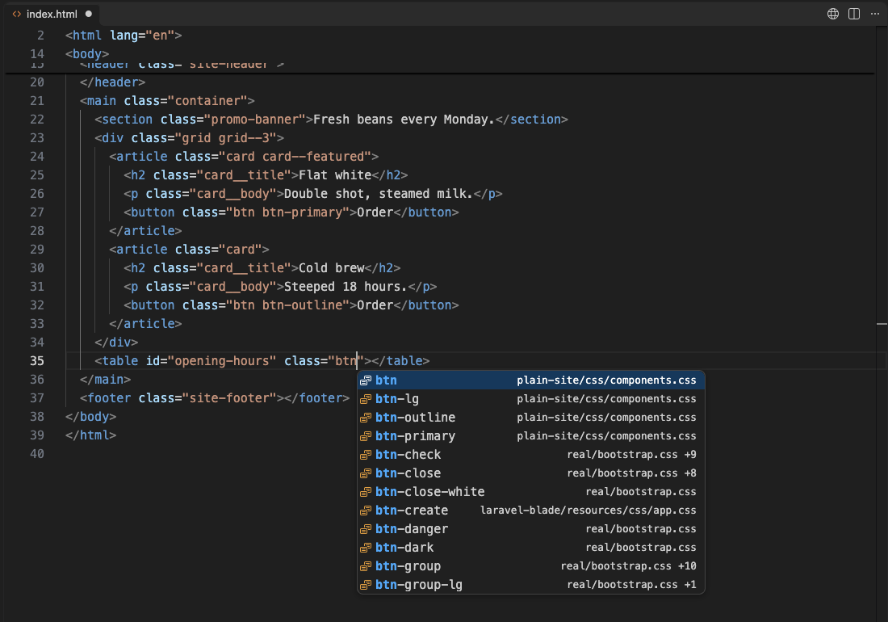
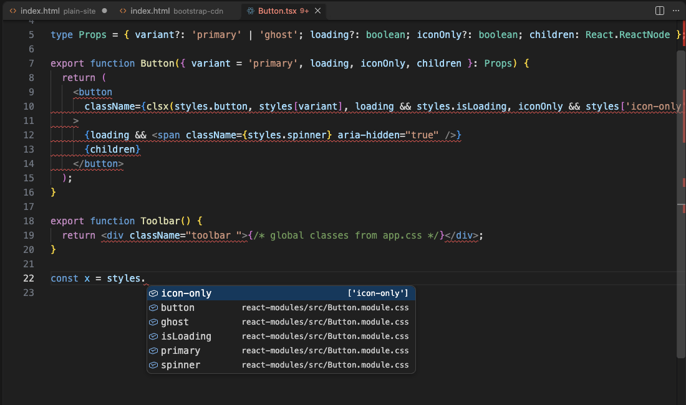

# HTML CSS Support & CSS Class IntelliSense

**Class names and id completion from your own CSS, SCSS and Less files, in every template language. Free, no sign-in, works offline.**

Type inside `class="..."` and the class names from every style sheet in your workspace show up, with the file each one comes from. Hover a name to see its CSS rule. Press F12 to jump to it.

- Works out of the box: every `.css`, `.scss` and `.less` file in the workspace, `<style>` blocks in the same file and `<link rel="stylesheet">` sheets. No setup, no config file.
- Every template language: HTML, JSX and TSX (`className`, `clsx()`, `cn()`, `cva()`), Vue (`class`, `:class`), Svelte (`class:` too), Angular (`[ngClass]`), Astro, PHP, Blade, Twig, ERB, Razor, Jinja, Liquid and more.
- CSS modules: `styles.` completes the classes of the imported `.module.css` / `.module.scss` file. Names with a dash become `styles['btn-primary']`.
- Light on CPU: it reads style sheets once, in the background, and then only the file you change. node_modules, `files.exclude` and `.gitignore` are skipped. No CPU use while you type in other files.
- Never changes your text: it only offers completions. Nothing is inserted or rewritten while you type.
- Nothing leaves your computer: it never downloads a remote style sheet. Bootstrap 5 and Bulma class lists ship with it, for pages that load them from a CDN.

## Why another one

The two big class completion extensions get the same complaints in their reviews:

| Complaint in reviews | What this extension does |
| --- | --- |
| "It does not suggest class or id names in a linked style sheet", "doesn't work in my Vue 3 project" | Reads the whole workspace, `<link>` sheets and `<style>` blocks. Vue `:class` objects, JSX, Svelte, Blade and CSS modules work without settings. |
| "Using lots of CPU on a large monorepo crashes VS Code", "It costs all resources" | Skips node_modules and ignored folders, stops at 5,000 sheets and 2 MB per sheet (both settings), indexes in the background, then only re-reads changed files. In our test workspace the extension host was at 0% CPU right after indexing. |
| "Breaking my code in blade files, duplicate word and letters while typing" | Completion only. A picked name replaces the word under the cursor and nothing else. |

## How it looks

Hover a class name to see the rule (selector and first declarations) and the style sheet and line it comes from. F12 opens it.

CSS modules in a React component:

## Where names complete

| File | Where |
| --- | --- |
| HTML, PHP, Blade, Twig, ERB, Razor, Jinja, Liquid, Handlebars | `class="..."`, `id="..."`, also between `{{ }}` / `<?php ?>` parts of the value |
| React (JSX, TSX) | `className="..."`, `className={'...'}`, `` className={`...`} ``, `clsx()`, `cn()`, `cx()`, `classnames()`, `twMerge()`, `cva()`, `tv()` |
| Vue | `class="..."`, strings in `:class="{ 'is-active': on }"` and `:class="['a', b]"`, `$style.` for `<style module>` |
| Svelte | `class="..."`, `class:name={...}` |
| Angular | `class="..."`, strings in `[ngClass]` and `[class]` |
| Astro | `class="..."`, `class:list={[...]}` |
| JS and TS | `styles.` and `styles['...']` for imported CSS modules, helper functions such as `clsx()` |

The class names come from:

1. `<style>` blocks in the same file (Vue and Svelte `lang="scss"` too) and the sheets the page links. These are listed first.
2. Every CSS, SCSS, Less and PostCSS file in the workspace. SCSS and Less nesting is resolved: `.card { &__title {} }` gives `card__title`.
3. The bundled Bootstrap 5 or Bulma list when you turn it on (setting `htmlCssClass.frameworks`). When a page loads Bootstrap or Bulma from a CDN, the extension asks once.

Vue and Svelte files need their usual language extension (Vue - Official, Svelte for VS Code) so VS Code knows the file type.

## Big projects and large files

- Style sheets over 2 MB (`htmlCssClass.maxFileSizeKB`) are skipped without being read. The index report lists them and a single message says how many.
- The index stops at 5,000 sheets (`htmlCssClass.maxFiles`) and 50,000 names per sheet.
- Broken SCSS or CSS does not stop it: the names before the error are indexed.
- Completion reads only the few thousand characters before the cursor, so it is as fast in a huge file as in a small one. With tens of thousands of classes it sends the best 5,000 matches and asks again as you type.
- Measured in real VS Code 1.142 on a MacBook: 16 style sheets (real Bootstrap 5.3, Bulma 1.0 and animate.css among them, 7,408 classes) indexed in 262 ms. With the size limit raised, a full re-index that included a 4.3 MB sheet with 100,000 selectors took 280 ms (32,505 classes in all). The extension host used 73 MB and 0% CPU when idle.

Run the command "CSS Class IntelliSense: Show index report" to see what was indexed and what was skipped. The status bar shows the number of classes; its tooltip has the same links.

## Settings

| Setting | Default | What it does |
| --- | --- | --- |
| `htmlCssClass.exclude` | node_modules, .git, build caches | Globs that are not indexed, on top of `files.exclude` and `.gitignore` |
| `htmlCssClass.includePackages` | `[]` | node_modules packages to index anyway, such as `bootstrap` |
| `htmlCssClass.frameworks` | `[]` | `bootstrap5`, `bulma`: bundled class lists for CDN users |
| `htmlCssClass.classFunctions` | clsx, cn, cx, ... | Functions whose strings hold class names |
| `htmlCssClass.maxFiles` | 5000 | The most style sheets to index |
| `htmlCssClass.maxFileSizeKB` | 2048 | Larger sheets are skipped |
| `htmlCssClass.validate` | `false` | Faint hint on class names that no sheet defines |
| `htmlCssClass.languages` | 28 template languages | Where names complete |

## Privacy

No network requests, no telemetry, no account. The index lives in memory and is gone when you close the window. Remote style sheets (`https://...`) are never fetched.

## Support Zovo

Zovo extensions are free, with no ads and no tracking. They are made by [theluckystrike](https://github.com/theluckystrike) on GitHub. If this one saves you time, you can support the work:

- [Sponsor on GitHub](https://github.com/sponsors/theluckystrike)
- [PayPal](https://www.paypal.com/paypalme/najzzz)
- [Follow theluckystrike on GitHub](https://github.com/theluckystrike)

## More tools by Zovo

- [SVG Viewer & SVG Preview (Zoom, PNG Export)](https://marketplace.visualstudio.com/items?itemName=zovo.zovo-svg-viewer) live preview beside the editor, zoom at the cursor, scripts never run. SVG preview and SVG viewer for VS Code: pan, viewBox outline, checkerboard or custom background, sprite sheet grid for <symbol>, .svgz, and PNG export at 1x to 8x. Free, offline.
- [Font Viewer, TTF Viewer, OTF & WOFF Viewer, Font Preview](https://marketplace.visualstudio.com/items?itemName=zovo.font-viewer-vscode) opens TTF, OTF, WOFF, WOFF2 and TTC fonts with a glyph grid, a type tester with variable axes and the license fields.
- [HAR Viewer & HAR File Analyzer (HTTP Archive, Network Log)](https://marketplace.visualstudio.com/items?itemName=zovo.zovo-har-viewer) opens HAR files from browser DevTools with a timing waterfall, filters and a redacted copy for sharing.
- [Large JSON Viewer, JSON Browser & JSON Tree](https://marketplace.visualstudio.com/items?itemName=zovo.zovo-json-tree-viewer) shows large JSON files as a searchable tree, copies JSONPath and turns arrays of objects into a table.
- [Mermaid Viewer & Mermaid Preview (MMD Diagram, No Sign-In)](https://marketplace.visualstudio.com/items?itemName=zovo.mermaid-viewer) no sign-in, no AI. Zoom, pan and export SVG or PNG. Free Mermaid diagram viewer and Mermaid preview for .mmd files and mermaid blocks in Markdown, works offline.

See [all Zovo extensions on the Marketplace](https://marketplace.visualstudio.com/publishers/zovo).

## License

MIT. The bundled Bootstrap and Bulma class lists come from their MIT-licensed CSS; see [THIRD-PARTY-NOTICES.md](THIRD-PARTY-NOTICES.md).
